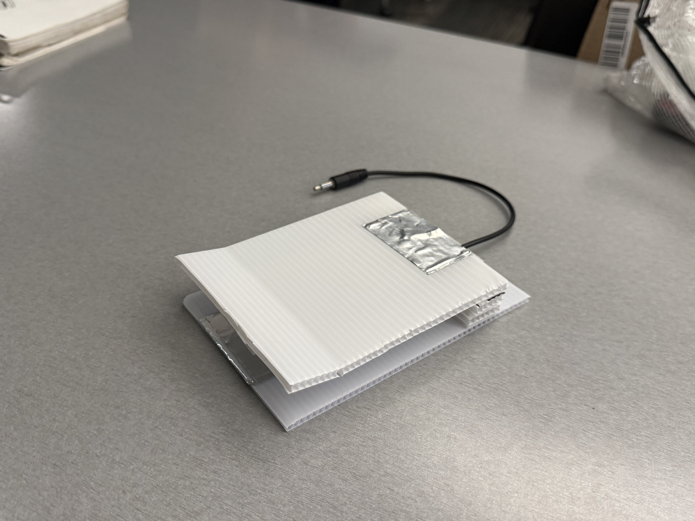
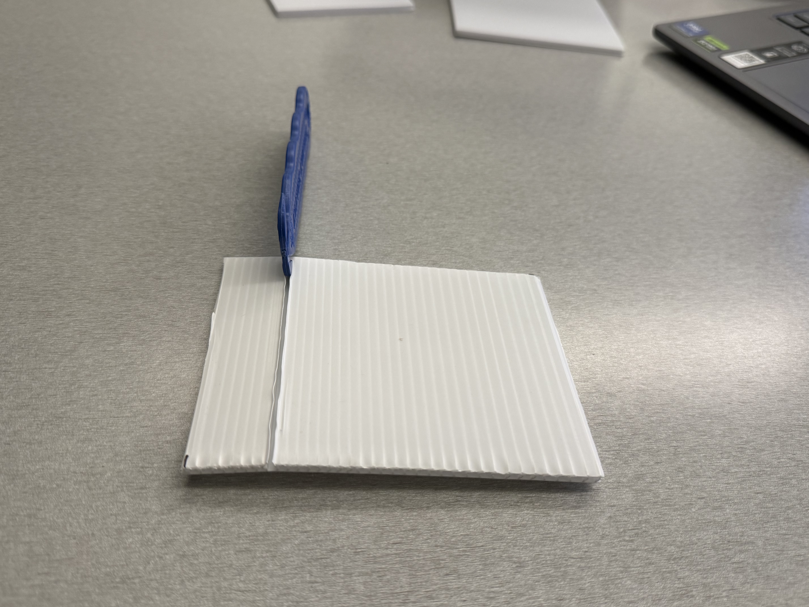

# How to Build a Paddle Switch

Version 0.1.0 and 21 November 2026

## Introduction
- The Paddle Switch is a device that is operated by pressing down on one end of the paddle until the two pieces of plastic touch. This device can be used in place of the often expensive commercially avaible adaptive switches to activate switch adapted toys. It is good for large movements and users who benefit from a large activation surface.
- This guide explains how to build a Paddle Switch using inexpensive materials and basic tools.

> For more information, reach out to HuskyADAPT at adaptuw@uw.edu.

### Device details
- **Name**: Paddle Switch
- **Original Creator**: [Mia Hoffman](https://miahoffmannd.github.io/)
- **Link**: [https://miahoffmannd.github.io/switchkit/Switches](https://miahoffmannd.github.io/switchkit/Switches)

### Device features
| Durable | Fast to Build | Works with any switch toy adaptation or input device |
|-------|-------|--------|
| strong_icon   | lightning_icon   | check_icon    |

Sensory outputs involved in operation of the toy.

### Adaption difficulty
**Difficulty 1/3: Beginner-friendly**

Complexity level of adaptation and description of prior experience required.
Ex. This project requires beginner-level soldering and hand-tool usage; Advanced experience in soldering required for this project.  

<!-- Linky like AWESOME -->
<!-- Phrased for SEO/AEO/GEO -->
<!-- https://marketplace.visualstudio.com/items?itemName=huntertran.auto-markdown-toc -->
## Table of contents
- [How to Build a Paddle Switch](#how-to-build-a-paddle-switch)
  - [Introduction](#introduction)
    - [Device details](#device-details)
    - [Device features](#device-features)
    - [Adaption difficulty](#adaption-difficulty)
  - [Table of contents](#table-of-contents)
  <!-- - [General procedure](#general-procedure) -->
  - [Safety precautions](#safety-precautions)
  - [Tools and setup](#tools-and-setup)
  - [Full procedure](#full-procedure)
    - [Part 1: Prepare the pieces](#part-1-prepare-the-pieces)
      - [Step 1: Cutting the pieces](#step-1-cutting-the-pieces)
      - [Step 2: Score the piece](#step-2-score-the-piece)
    - [Part 2: Taping the pieces](#part-2-taping-the-pieces)
      - [Step 1: Prepare the Base (A)](#step-1-prepare-the-base-a)
      - [Step 2: Prepare the Paddle (B)](#step-2-prepare-the-paddle-b)
    - [Part 3: Assembling the switch](#part-3-assembling-the-switch)
      - [Step 1: Audio jack attachment](#step-1-audio-jack-attachment)
      - [Step 2:](#step-2)
      - [Step 3:](#step-3)
      - [Step 4:](#step-4)
  - [Appendix](#appendix)
    - [Troubleshooting](#troubleshooting)
    - [FAQ](#faq)
    - [Resources](#resources)
    - [Acknowledgements](#acknowledgements)
    - [About HuskyADAPT and Instructional Systems](#about-huskyadapt-and-instructional-systems)

## Safety precautions
<!-- https://facilities.uw.edu/partner-resources/files/media/box-cutter-safety.pdf -->
This build requires the use of a box cutter.

To prevent injuries while using one of the many types of box cutters, consider the following:
- **Keep the blade sharp** – Sharp blades will cut. Dull blades will tug and pull, which is more likely to cause your hand to slip and cut your fingers. Replace when dull, and never use a broken blade!
- **Shorten the blade** – Most box cutters allow you to choose the length of the blade. Keep the blade as short as possible.
- **Keep it covered** – Retract the blade as soon as possible. When you put your box cutter away, make sure that it's protected with a cover.
- **Angle it away from your body** – Never cut directly towards you. If you cut at an angle, your hand will move away from your body if it slips.
- **Cut deliberately** – Apply a consistent, firm (but not excessive) pressure while performing the cut. Use your arm to move the blade in a deliberate motion so that slipping becomes unlikely. Concentrate on the material to be cut and watch the blade at all times.
- **Keep your thumb away** – It's tempting to put your thumb right by the blade when you cut since you get better balance, but don't put your thumb anywhere near the blade. 
- **Put your other hand away** – You don't need to put your hand right by the blade when you cut. Put your hand far enough away and back to avoid cutting it.

## Tools and setup
Link out.

<!-- Kept linear for screen reader convenience and less whitespace -->
## Full procedure
### Part 1: Prepare the pieces
#### Step 1: Cutting the pieces

*The four pieces of cut coroplast needed for assembly of the paddle switch*

Cut four pieces of corrugated plastic (coroplast):
- **Base (A):** 5.75 x 4 inches.
  - > ✏️ **Note**: Flutes (the internal channels in the plastic) should be parallel with the short edge.
- **Paddle (B):** 5 x 4 inches.
  - > ✏️ **Note**: Flutes should run along with the short edge.
- **Shim (C):** 4 x 1 inches.
  - > ✏️ **Note**: Flute direction does not matter.
- **Shim (D):** 4 x 1 inches.
  - > ✏️ **Note**: Flute direction does not matter.

<!--
> ⚠️ **Caution**: Caution. 
> 💡 **Tip**: Tip.   
-->

---

#### Step 2: Score the piece

*The paddle piece being scored using a razor blade*

Score (cut part way through) the Paddle (A) piece, along the short 4 inch side, 1 inch away from the edge.

---

### Part 2: Taping the pieces
#### Step 1: Prepare the Base (A)

*Caption here*

Add two pieces of 5 inch aluminum conductive tape to the Base (A). Center and overlap the pieces so that there is a X inch border between the edge of the piece and the tape.

Place a 1 inch piece of foam tape in the middle of the 4 inch side between the tape and the edge.

#### Step 2: Prepare the Paddle (B)

*Caption here*

Add a 6 inch piece of aluminum conductive tape to the Paddle (B). Center the piece and leave X inch from the scored side. 

Wrap the last inch around the non-scored edge.
<!-- > ✏️ **Note**: Note.

> ⚠️ **Caution**: Caution. 

> 💡 **Tip**: Tip.   -->

---

### Part 3: Assembling the switch
#### Step 1: Audio jack attachment

*Caption here*

Place audio jack cable on foam tape:
- Use 5 inch aluminum tape to secure red wire to Base A
- Red wire should be attached along long edge

#### Step 2: 

*Caption here*

Use foam tape to secure shims on base A:
- Shims should stack along short edge of base A
- Secure shims close to black wire but keep white wire out
 
 #### Step 3: 
 
*Caption here*

 Secure paddle B to foam tape on top of shims
-  Align front edges

#### Step 4:

*Caption here*

Tape white wire to top with aluminum tape
- Ensure wire and tape are firmly attached

<!-- > ✏️ **Note**: Note.

> ⚠️ **Caution**: Caution. 

> 💡 **Tip**: Tip.   -->

---

## Appendix

### Troubleshooting
Link out.

### FAQ
Link out.

### Resources
- List of links?

### Acknowledgements
- https://miahoffmannd.github.io/switchkit/Switches
<!-- Resources used to develop this manual. People who helped: contributors, editors, etc. -->

<!-- Should also live in the style guide. Will be under development! -->
### About HuskyADAPT and Instructional Systems
Description.
