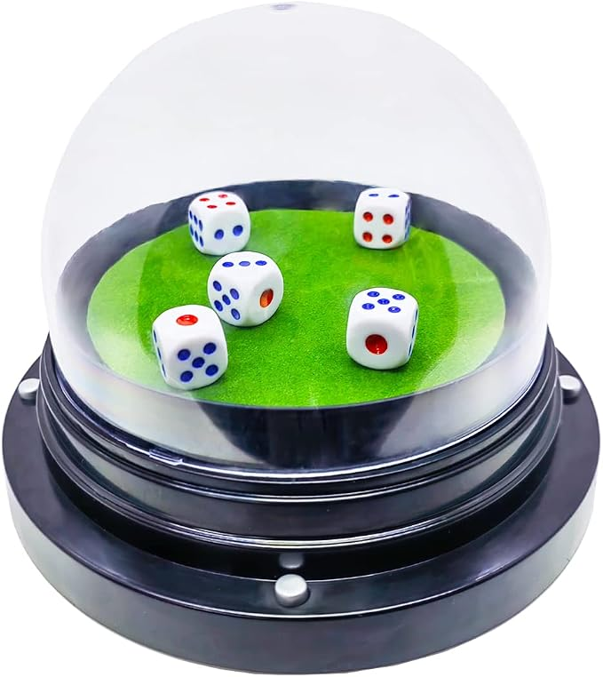
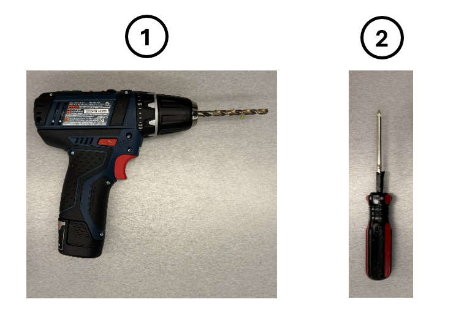
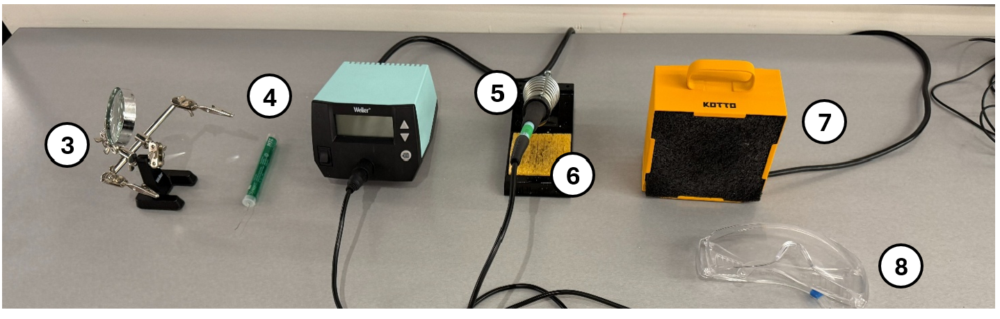
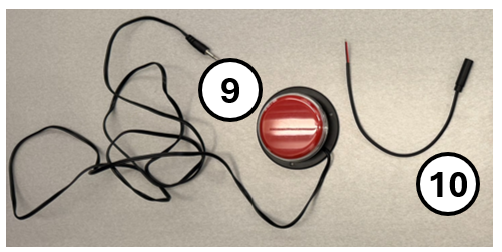

<!-- Phrased for SEO/AEO/GEO -->
# How to Adapt Dice Roller

<!-- AWESOME version no. and date -->
<!-- How to number should go in style guide -->
Version 1. Last updated on 22 November 2026.

<!-- Many teams included alt text eyyy -->

 

<!-- YMCV key intro info -->
# Introduction
* The dice roller is a toy with a spinner inside that rolls dice and is activated with a press of one of four buttons. It can be used for playing all sorts of games including table top roleplaying games like Dungeons and Dragons, board games like Monopoly, and strategy games like Mahjong, among others. 
* This adaptation guide explains how to adapt the functionality of any of the four buttons used to make the dice roll, so that they can be activated with the press of a singular, large button. 

<!-- KALM good standard inclusion -->
> For more information, reach out to HuskyADAPT at adaptuw@uw.edu.

<!-- KALM good standard info -->
## Toy details
**Link**: [Amazon link to dice roller](https://a.co/d/0alVkROF)  
**Name**: Automatic Dice Roller Cup with Dices for Adults Party Table Games EK1981  
**Brand**: Gikfun  
**ASIN**: B0BNT3Z7QN

## Toy features
| Light | Sound | Motion |
|:---:|:---:|:---:|
|💡|🔊|🔃|
|❌|✅|✅|

Pressing any of the four buttons on the dice roller makes the spinner inside to spin, causing the dice to roll and make a rattling sound.
## Adaption difficulty
**Difficulty 1/3: Beginner-friendly**

This project requires beginner-level soldering and hand-tool usage. 

<!-- Linky like AWESOME -->
<!-- Phrased for SEO/AEO/GEO -->
<!-- https://marketplace.visualstudio.com/items?itemName=huntertran.auto-markdown-toc -->
# Table of contents
- [How to Adapt Toy Name](#how-to-adapt-toy-name)
- [Introduction](#introduction)
    - [Toy details](#toy-details)
    - [Toy features](#toy-features)
    - [Adaption difficulty](#adaption-difficulty)
- [Table of contents](#table-of-contents)
- [General procedure](#general-procedure)
- [Safety precautions](#safety-precautions)
- [Tools and setup](#tools-and-setup)
- [Full procedure](#full-procedure)
    - [Part 1: Preparing the toy](#part-1-preparing-the-toy)
        - [Step 1: Remove the toy from the package](#step-1-remove-the-toy-from-the-package)
        - [Step 2: Declarative step](#step-2-declarative-step)
        - [Step 3: Declarative step](#step-3-declarative-step)
    - [Part 2: Understanding the circuit board](#part-2-understanding-the-circuit-board)
    - [Part 3: Making space for the new switch](#part-3-making-space-for-the-new-switch)
    - [Part 4: Soldering](#part-4-soldering)
        - [4.1: Custom Soldering 1](#41-custom-soldering-1)
        - [4.2: Custom Soldering 2](#42-custom-soldering-2)
    - [Part 5: Testing and reassembling the adapted toy](#part-5-testing-and-reassembling-the-adapted-toy)
- [Appendix](#appendix)
    - [Troubleshooting](#troubleshooting)
    - [FAQ](#faq)
    - [Resources](#resources)
    - [Acknowledgements](#acknowledgements)
    - [About HuskyADAPT and Instructional Systems](#about-huskyadapt-and-instructional-systems)

<!-- Present in every manual for convenience and safety -->
<!-- Should go in the style guide (up for editing) -->
# General procedure
<!-- Source: https://uwnetid.sharepoint.com/:p:/s/huskyadapt/cQr_xZxmDFQlSrafDVBPPkZsEgUCJVXRQgi2niDiJS1xfOS7MA -->
The general procedure for toy adaptation is as follows:  

1. Unpackage the toy.
2. Assess the toy's functions. Determine what components you want to make switch-accessible.  
3. Take the toy apart.  
4. Identify the main circuit points responsible for the function(s) selected.
5. Drill a hole into the toy case and feed the switch wires through.
6. Solder an audio jack in parallel to the main circuit.  
7. Test the toy.  
8. Once it works, put the toy back together.

<!-- Present in every manual for convenience and safety -->
<!-- Should go in the style guide (up for editing) -->
# Safety precautions
This adaptation requires the use of a soldering iron and drill.  

When drilling or soldering:
- Be alert and aware of your surroundings.
- Wear safety goggles.
- Tie back long hair and secure loose-fitting clothing.
- Take all batteries out of the toy.

When soldering:
- Ensure that you are in a well-ventilated room. Turn on a fan if possible.
- Ensure soldering iron cords will not be tripped over.
- Keep your hands away from the iron tip, soldering connection, or anything that has recently touched the tip.

When drilling:
- Drill away from yourself and watch your fingers.  

# Tools and setup
## Tools

1. Electric drill with a drill bit at least 3/8" 
2. Small Phillips head screwdriver 

### Soldering Tools
 
3. Alligator clip wire holder (optional)
4. Lead-free solder
5. Soldering iron and stand
6. High-temperature sponge or brass wool
7. Fan
8. Safety glasses

## Extra Materials

9. Switch
10. 3.5mm headphone jack

## Setup
<figure>

<figcaption>Example setup</figcaption>
</figure>

Set up a well-ventilated workspace with a clear desk or workbench. Work near an open window, outdoors, or under a vent hood or fume extractor. Plug the soldering iron in, set it on the stand, and ensure it is easy to reach.

<!-- Kept linear for screen reader convenience and less whitespace -->
# Full procedure
## Part 1: Preparing the toy

<!-- Subsection as heading allows for clearer distinction of which images belong to which step -->
### Step 1: Remove the toy from the package

*Caption here*  

<!-- Many teams used the quotation function for visual callouts (slay) -->
<!-- YMCV provided emojis! -->

> ✏️ **Note**: Note.

> ⚠️ **Caution**: Caution. 

> 💡 **Tip**: Tip.  

<!-- Separators from KALM; good visual separation between steps -->
---

### Step 2: Declarative step

*Caption here*  

---

### Step 3: Declarative step

*Caption here*  

---

## Part 2: Understanding the circuit board

---

## Part 3: Making space for the new switch

---

## Part 4: Soldering

<!-- Custom options from TBD -->
### 4.1: Custom Soldering 1

### 4.2: Custom Soldering 2

---

<!-- Part 5 from TBD -->
## Part 5: Testing and reassembling the adapted toy

---

<!-- Completely new -->

# Appendix

## Troubleshooting
"I'm having trouble with..."

<h3>Soldering</h3>

<h4>What if I melt too much metal when soldering and the nodes on my circuit board touch?</h4>

 
If 2 solder nodes are unintentionally connected, this is called a solder bridge. To remove excess solder:

1. Place a solder wick (desoldering braid) over the solder bridge, then place your soldering iron on top of the wick to melt the excess solder. The wick will absorb the excess solder.
2. Once the excess solder is absorbed, lift the iron and wick away together.

<h4>How would I fix the wire if it is yanked out of the toy?
</h4>

The following steps are for wires disconnected from the solder nodes.

⚠️ These steps are not for when a copper pad is lifted off the circuit board.

1. Follow the same soldering steps as before.
2. Add a stopper. Leave a little slack on the wire between the solder node and wire exit. Secure a zip tie around the wire near the exit point. Trim the remaining length of the zip tie.

✏️ Helpful identifiers to know if your copper pad has lifted are when itlooks raised or curled, or moves when lightly touched. In this case, see a technician. 

 

<h3>Buttons</h3>

<h4>What do I do if the toy does not respond after adapting it and pressing the adapted switch?</h4>

> 🔋 **Check the batteries**  
> Make sure that you don't have a battery problem by pressing the button originally used to operate the toy. If the toy doesn't work still, replace the batteries and try again.
>
> 🔌 **Check the wiring**  
> If there are no issues with the batteries, check the headphone jack wiring and ensure that it is soldered securely to the ends of the original toy switch.

<h4>What do I do if the toy only activates when I'm holding down on the adapted switch?</h4>

> 🔌 **Connect to a switch modifier**  
> Connect one end of a [TNP 3.5mm mono cable](https://www.amazon.com/dp/B01MA18DPL?lv=shuf&channelId=500&plpRedirect=mhFallback) to the headphone jack and the other end to the output jack of a [switch modifier](https://www.switchedtoys.org/products/tiny-switchy?srsltid=AYCX9vKnXq7Cn-sA29axtcte3TYTOR1FWBG2FTAkK4Uz03Sk2XIitK1b&_su_rec=vZPz6UFR8OSA5pRh-t-S4XNZI8jjt-l23Dh_1j4u-f3Pi8DCE3JUE7TvYQctAbPJyUOJOvm6DHwR-2iTVvJfkotX6Cl1bxw8OdeDf4IbsU-es2YRGJUM4rtbSI5px2cR_C6OD7guhaAC7gpaN7Xc1CAwWQpmzmAbiOookgCQ3vfsf1teWKmvI7XDkEKJiyqfSqlz_B1WbqVhW0hxALAGHZoko-cBG6cQ71HBNyAe1xdJG9y6gPI4Rh6ziwpmmRO5fcEvWGU13-20EoK36pMrf7Nbrsbjp94IZZuUR3oebavKeO0gRFFEZU1M46sAhW5LOY7bwixJTOxhPstH-1PYO3E&_su_rec_id=8b5f9cdc-c0bd-444b-8e55-45712c671937-1794887596). Then, connect the headphone plug of your adapted switch to the input jack of the switch modifier and press the button for toggle mode. This should convert your adapted switch to a latching switch and the toy should stay activated after only one push of the adapted switch.
>
> *Note: a switch modifier is a device that makes it so that a toy can be turned on continuously or off, or on for a specific amount of time, with just a single push of an adapted switch and a latching switch is a switch that makes a toy stay in its new state (ON or OFF) after just one press.

<h4>What if the toy only works intermittently (might change the word due to common knowledge)?</h4>

    
> 🔌 **Check for loose connections**
>Inspect all solder joints on the headphone jack and original switch terminals. A loose or "cold" solder joint can cause the toy to work only some of the time.
>
> 🎧 **Test the switch and cable**
>Try a different adapted switch or cable if available. A damaged switch or cable may create an unreliable connection.
>
> 🔍 **Inspect the headphone jack**
>Ensure the jack is firmly mounted and that no wires are touching unintentionally inside the toy.
>
>&nbsp;
>💡 **Tip:**
>Gently wiggle the wires while testing the toy. If the toy cuts in and out, there is likely a loose connection that should be resoldered.

<h4>What if the toy's original functions stop working?</h4>

> 🔌 **Check the wiring placement**
> Verify that the headphone jack wires are connected only to the original switch terminals and have not accidentally bridged to nearby components or traces.
>
> 🤝 **Inspect for solder bridges**
> Look for excess solder connecting two points that should remain separate. Remove any solder bridges using solder wick if needed.
>
> 🔍 **Check the original button**
>Make sure the toy's original switch has not been damaged, disconnected, or obstructed during the adaptation process.
>
> ✅ Test the toy before closing the casing
 Operate both the original button and the adapted switch. Both should activate the toy in the same way.
>
> ⚠️ **If the issue persists**
>Stop troubleshooting and consult a technician to avoid damaging the circuit board.

<h3>Toy Casing</h3>

<h4>What if the toy casing won't close?</h4>

> 🤗 **Misaligned seams or tabs:**  
> Gently open the casing and make sure the internal alignment pins and edges line up evenly before pressing together.
>
> 📋 **Internal obstruction:**  
> Check that any internal components, wires, batteries, or inserts are seated flat inside their designated grooves and are not pinched between the halves.
>
> 🔎 **Excess material or debris:**  
> Inspect the edges for small plastic burrs, dried adhesive, or dust blocking the closure track.
>
> &nbsp;
>
> 💡 **Tip:**  
> Apply even, gentle pressure around the perimeter rather than forcing one side down, which can bend or snap the locking tabs.

## FAQ
Link out.

## Resources
- List of links?

## Acknowledgements
Resources used to develop this manual. People who helped: contributors, editors, etc.

<!-- Should also live in the style guide. Will be under development! -->
## About HuskyADAPT and Instructional Systems
Description.
